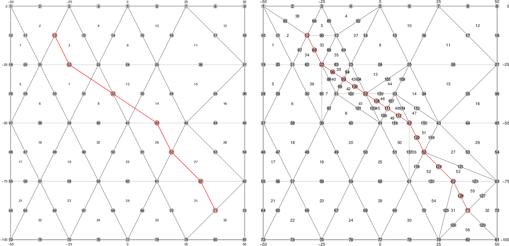

# QuadReg
Fortran algorithm for the automatic mesh refinement of a quadratic triangular grid cutted by a line.

In `fault_refinement.f`, from line 256 on, declare the total number of nodes that initially compose the fault and the global numbering of each of them. 

Run the program with

```bash
    ./Ricominciamo.job
```
It allows the code to remesh the grid as cutted by the defined fault and generates the final picture. 

The following figure has been computed using:

```fortran
    nsn = 7

    snf(1) = 12
    snf(2) = 22
    snf(3) = 32
    snf(4) = 42
    snf(5) = 52
    snf(6) = 62
    snf(7) = 71
```



